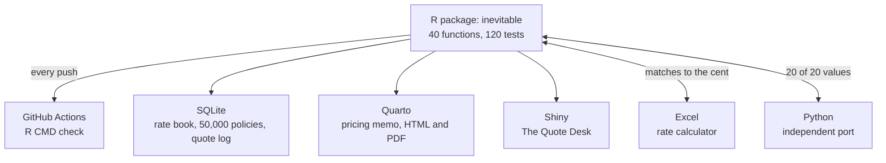

# Pricing the Inevitable

*Everyone dies. The premium is about when.*

[](https://github.com/soodpratham10/pricing-the-inevitable/actions/workflows/R-CMD-check.yaml)        

**[▶ Open The Quote Desk](https://soodpratham10.shinyapps.io/pricing-the-inevitable/)** · **[📄 Read the pricing memo](report/pricing-memo.pdf)** · **[📚 Function reference](https://soodpratham10.github.io/pricing-the-inevitable/)**

## You're at the quote desk

A 40-year-old walks in and asks for $250,000 of whole life insurance. The net premium is **$2,109.46 a year**. That number is a break-even *on average*, and it hides a bet: at that price the policy still loses money **one time in three**, because everyone who dies early is a loss.

How much should you charge to be 95% sure of not losing money?

| Policies sharing the risk | Premium for 95% confidence | Above the net premium |
|---|---|---|
| 1 | $6,589.87 | +212.4% |
| 100 | $2,401.47 | +13.8% |
| 1,000 | $2,200.39 | +4.3% |
| 10,000 | $2,138.08 | +1.4% |
| 100,000 | $2,118.50 | +0.4% |

That table is why insurance works. This project builds the engine behind it from first principles, for 19 insurance and annuity products, and puts it on a desk you can use.

## The Quote Desk

**[The Quote Desk](https://soodpratham10.shinyapps.io/pricing-the-inevitable/)** is a Shiny pricing desk in the style of a 1950s insurance office:

- 🖋 **The quote letter**: choose an applicant (age, underwriting class), a plan and a payment frequency; the desk types up a quote with the premium, the chance of a claim, the chance the policy loses money and the premium needed for 95% confidence. Print it, or file it in the session's quote book.
- 🎲 **Risk Lab**: four premium principles side by side, the probability of loss as the premium rises, and 1,000 simulated portfolios checking the normal approximation.
- ⏳ **Mortality Lab**: Makeham, Gompertz, de Moivre, constant force and Weibull, and three ways of spreading deaths within a year.
- 🗄 **Product Shelf**: all 19 products for any age, with the full distribution of each one's present value.
- ⚖ **Natural Hedge**: the mix of annuities and life insurance that cancels a mortality shock.
- 🔖 **Beat the Underwriter**: guess the premium for a random applicant and get stamped APPROVED, REFERRED or DECLINED.

**[How the desk works →](docs/the-quote-desk.md)**

## What the project found

| Finding | Numbers |
|---|---|
| A net premium breaks even only on average | Whole life at 40 loses money with probability 33.8% at its net premium of $2,109.46 |
| Pooling makes certainty cheap | 95% confidence costs +212% for one policy and +4.3% across 1,000 |
| A percentile premium alone can give cover away | For 20-year term at 40 the 95% percentile premium is **$0**, because death within 20 years has probability 4.2% |
| Smokers pay less for annuities | The deferred annuity from 65 costs smokers 18% less: they are expected to collect it for fewer years |
| A flat extra hits term insurance hardest | +0.005 on the force of mortality multiplies 10-year term at 40 by 5.5, but whole life by only 1.46 |
| Paying monthly costs about 2% more a year | The insurer waits for its money and stops collecting at death |
| Insurance and annuities hedge each other | 0.26 annuities of $20,000 a year per $250,000 policy cut the effect of a 10% mortality shock from $1.59 million to $15,855 |

## The chapters

| Chapter | The story | Actuarial content | Code |
|---|---|---|---|
| 1. [**The Clock**](docs/chapters/01-the-clock.md) | How long will they live? | Laws of mortality, select mortality, extra risk, fractional ages | `R/mortality.R` |
| 2. [**Paying at Death**](docs/chapters/02-paying-at-death.md) | Insurance | Eight insurance benefits: EPV, variance, full distribution, identities | `R/products.R` |
| 3. [**Paying for Life**](docs/chapters/03-paying-for-life.md) | Annuities | Eleven annuities; m-thly by exact sums, UDD and Woolhouse; benefits at the moment of death | `R/products.R`, `R/frequency.R` |
| 4. [**The Quote**](docs/chapters/04-the-quote.md) | Premiums | Equivalence, percentile, portfolio percentile, premium refunds, the rate book, the natural hedge | `R/premiums.R`, `R/ratebook.R`, `R/hedge.R` |

## How it's built



| Tool | Its job |
|---|---|
| **R package** | The engine, `inevitable`: 40 documented functions, 120 tests, checked by GitHub Actions on every push |
| **SQL (SQLite)** | The back end of a quoting system: plans, classes, a 424-rate rate book, 50,000 simulated policies with actual vs expected losses, a quote log, and views an agent would read |
| **Excel** | A working rate calculator with dropdowns, its own life table in formulas, a lookup in the R rate book and a 10-item cross-check |
| **Quarto** | [A pricing memo](report/pricing-memo.pdf) to a (fictional) pricing committee, every number computed live |
| **Python** | An independent numpy port of the engine that reproduces 20 key results from R |
| **Shiny** | [The Quote Desk](https://soodpratham10.shinyapps.io/pricing-the-inevitable/) |

## How correctness is checked

- **Hand calculations**: a three-year life worked on paper (q = 0.1, 0.2, 1 at 10%) for insurance, annuities, premiums and premium refunds.
- **Identities**: A = 1 − d ä; endowment = term + pure endowment; increasing + decreasing term = (n + 1) × term; Var(Y) = Var(Z)/d²; the UDD m-thly formula equals the exact UDD sum; key relations between deferred, guaranteed and term annuities.
- **Independent rebuilds**: Excel to the cent, Python to 1e-14, SQL against the model's probabilities of loss.
- **Automation**: `R CMD check` with every test on every push ([see the runs](https://github.com/soodpratham10/pricing-the-inevitable/actions)).

## Try the engine

```r
# install.packages("devtools")
devtools::install_github("soodpratham10/pricing-the-inevitable")
library(inevitable)

m <- mortality_law()                                   # the project's Gompertz-Makeham law
q <- class_q_path(m, 40, "Smoker")                     # a newly underwritten 40-year-old smoker
net_premium("term", q, i = 0.045, S = 250000, n = 20, t = 20)
portfolio_premium("whole_life", q_path(m, 40), 0.045, S = 250000, N = 1000)
natural_hedge(m)$ratio
```

More in **[Getting started](docs/getting-started.md)**.

## About

Built by **Pratham Sood**, Actuarial Mathematics and Statistics, University of Manitoba. The idea grew out of a life contingencies course assignment that valued standard insurances and annuities. This project rebuilds it from scratch with its own assumptions, and goes further: full loss distributions, risk-based premiums, underwriting, the natural hedge, and a tested R package.

Companion projects: [The Odds of a Lifetime](https://github.com/soodpratham10/odds-of-a-lifetime) (an insurer over 20 years) and [Matching the Promise](https://github.com/soodpratham10/matching-the-promise) (the assets behind an annuity block).

*All assumptions are illustrative and not calibrated to real data. Net premiums only: no expenses or profit. Nothing here is a real offer of insurance.*
